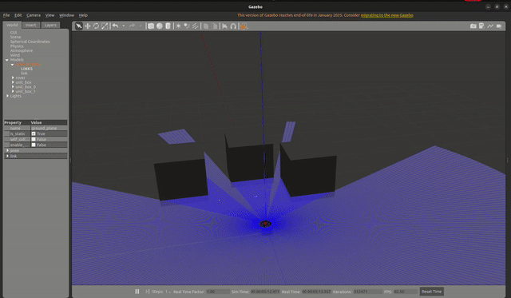
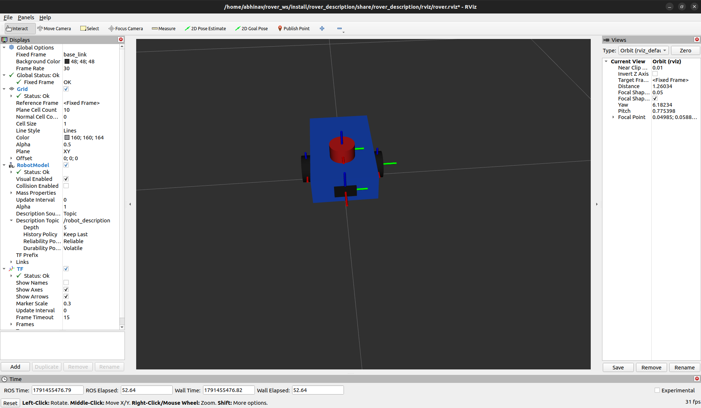
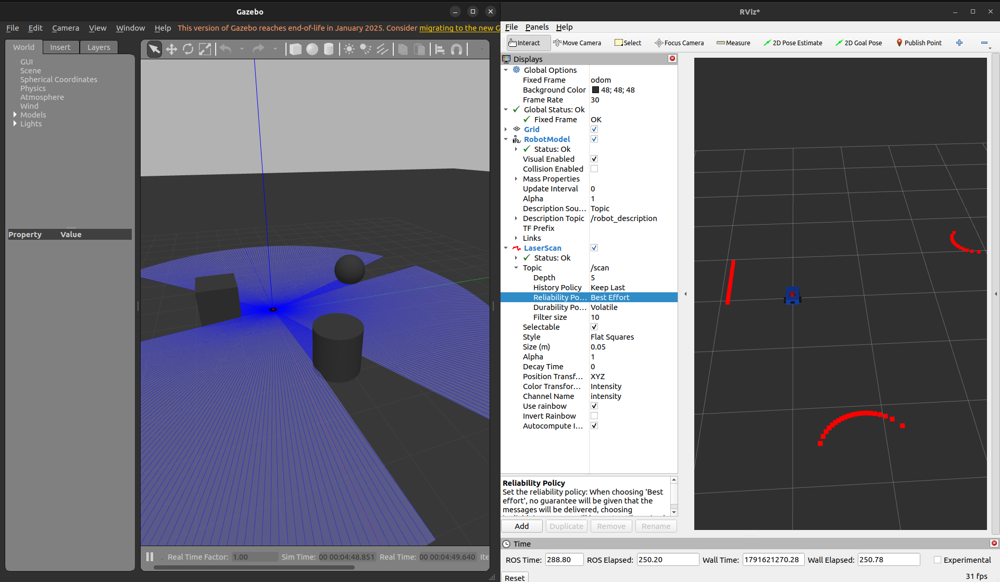

# Rover: ROS 2 Differential-Drive Robot with Obstacle Avoidance

A differential-drive rover for ROS 2 Humble. It is modelled in URDF/Xacro, simulated in Gazebo Classic with a lidar, and drives itself around obstacles with a Python control node.



## What it does

- Parametric Xacro model with a reusable wheel macro
- Gazebo simulation with a differential-drive plugin (`/cmd_vel` in, `/odom` out)
- Simulated 360° lidar publishing `/scan`
- Reactive obstacle avoidance: drives forward, turns toward the more open side when something is closer than a set distance
- Stop conditions: time limit, trapped on all sides, and stop on exit
- RViz setup for viewing the robot model and the lidar scan

| RViz model | Gazebo and lidar scan |
|---|---|
|  |  |

## Packages

| Package | Contents |
|---|---|
| `rover_description` | Xacro robot model, Gazebo materials, friction, diff-drive and lidar plugins, launch files, RViz config |
| `rover_control` | `drive_forward`, `scan_reader` and `obstacle_avoider` nodes |

## Robot structure

```
base_link
 ├── wheel_left   (continuous joint)
 ├── wheel_right  (continuous joint)
 ├── caster       (fixed joint)
 ├── lidar_link   (fixed joint, simulated lidar sensor)
 └── camera_link  (fixed joint, frame only)
```

## Requirements

- Ubuntu 22.04
- ROS 2 Humble
- Gazebo Classic 11

```bash
sudo apt install ros-humble-gazebo-ros-pkgs ros-humble-xacro \
  ros-humble-joint-state-publisher-gui ros-humble-rviz2 \
  ros-humble-teleop-twist-keyboard
```

## Build

```bash
git clone https://github.com/abhinav-006/rover_ws.git
cd rover_ws
source /opt/ros/humble/setup.bash
colcon build --symlink-install
source install/setup.bash
```

## Run

**View the model in RViz, with sliders for the wheel joints:**

```bash
ros2 launch rover_description display.launch.py
```

**Simulate in Gazebo:**

```bash
ros2 launch rover_description gazebo.launch.py
```

Drive it by hand in a second terminal:

```bash
ros2 run teleop_twist_keyboard teleop_twist_keyboard
```

**Obstacle avoidance.** Place a few objects around the rover in Gazebo, close the teleop terminal, then run:

```bash
ros2 run rover_control obstacle_avoider
```

Settings can be changed at start-up:

```bash
ros2 run rover_control obstacle_avoider --ros-args -p stop_distance:=0.8 -p max_run_time:=20.0
```

| Parameter | Default | Meaning |
|---|---|---|
| `stop_distance` | 0.5 | Distance in meters at which the rover turns away |
| `forward_speed` | 0.15 | Forward speed in m/s |
| `turn_speed` | 0.8 | Turning speed in rad/s |
| `max_run_time` | 0.0 | Stop after this many seconds (0 = never) |

**View the lidar scan in RViz** while Gazebo is running:

```bash
ros2 run rviz2 rviz2 --ros-args -p use_sim_time:=true
```

Set Fixed Frame to `odom`, add `RobotModel` and `LaserScan` (topic `/scan`, reliability `Best Effort`).

## How the avoidance works

Every scan, the node finds the nearest object in a front, left and right zone. If the front zone is closer than `stop_distance`, the rover turns toward the side with more room. Otherwise it drives forward. If all three zones are blocked it stops, and it resumes when the way clears.

## Roadmap

- [x] URDF/Xacro model and RViz visualization
- [x] Gazebo simulation with differential drive
- [x] Simulated lidar publishing `/scan`
- [x] Obstacle avoidance with stop conditions
- [ ] Camera sensor plugin
- [ ] SLAM with `slam_toolbox`
- [ ] Autonomous navigation with Nav2

## Author

Abhinav Bhandari